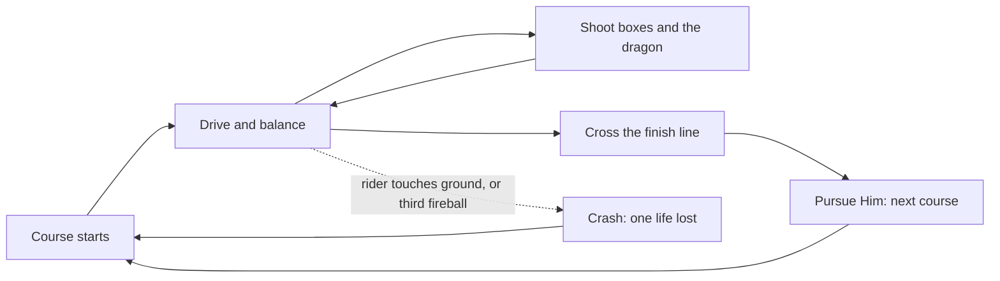
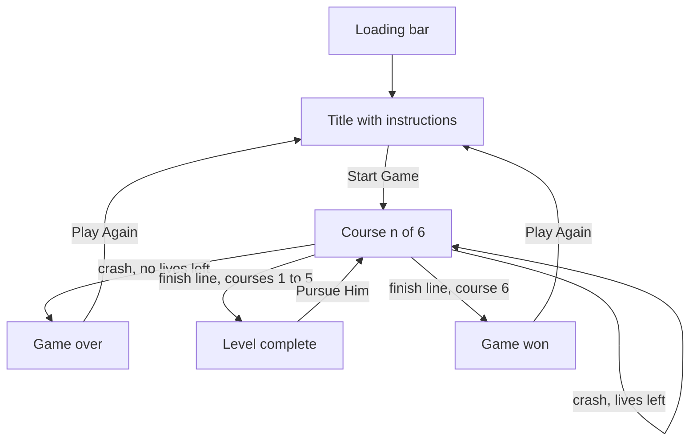
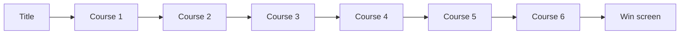
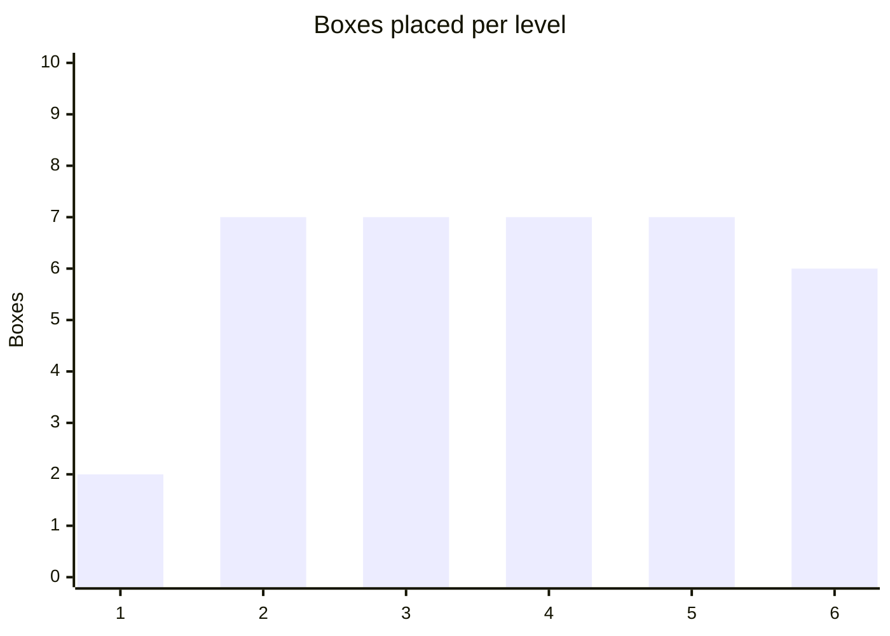

# Redakai vs Lokar — Game Design Document

| | |
|---|---|
| **Document** | Game Design Document (GDD), retrospective |
| **Game** | Redakai vs Lokar (Adobe Flash, AVM1 (ActionScript 1/2)) |
| **Version** | 1.0, 2026-11-24 |
| **Status** | Final |
| **Coverage** | 202 of 202 game functions matched; last name pass 2026-10-21T07:27:42Z |
| **Source of truth** | The matched source in `src/` and the original's records. Where this document and the source disagree, the source wins |

| Version | Date | Change |
|---|---|---|
| 0.1 | 2026-11-24 | Skeleton |
| 1.0 | 2026-11-24 | First issue: the whole game read from the matched source, the movie's records and renders of the original |

**Contents.** [1 About this document](#1-about-this-document) · [2 One-page design](#2-one-page-design) ·
[3 Game concept](#3-game-concept) · [4 Core gameplay](#4-core-gameplay) · [5 Player character and controls](#5-player-character-and-controls) ·
[6 Systems](#6-systems) · [7 Gameplay elements](#7-gameplay-elements) · [8 Bosses](#8-bosses) · [9 Story](#9-story) ·
[10 Level design](#10-level-design) · [11 User interface](#11-user-interface) · [12 Art direction](#12-art-direction) ·
[13 Audio](#13-audio) · [14 Technical summary](#14-technical-summary) · [15 Design analysis](#15-design-analysis) ·
[16 Open questions](#16-open-questions) · [17 References](#17-references)

---

## 1. About this document

This document describes Redakai vs Lokar as a design: what the player does, why it works the way it does, and how the content is
paced. It is written for designers, porters and students of the game. How the code is organised is the job of the
[architecture page](../ARCHITECTURE.md); this document is the game as a player and a designer see it.

The game shipped long before this document was written, so it records a finished design rather than proposing one. Every
statement carries one of four levels of certainty:

| Label | Meaning | Where it comes from |
|---|---|---|
| **Implemented** | The game does this. Unlabelled statements are at this level | The matched source and the original's records |
| **Stated** | The author's text says this; the code may or may not do it | The game's own text |
| **Derived** | Calculated from implemented values; nobody has measured it | Arithmetic shown with its inputs |
| **Inferred** | A reading of intent by the writer of this document | The layouts and the content order |

**Not play-tested.** No person played the game for this document. Two scripted sessions of the original movie were rendered and
looked at: the one the behaviour check keeps (its inputs are in `tests/behaviour/checkpoints.json`, and the
[preservation page](../PRESERVATION.md) says what it covers), and a short one made for this document that presses Start
straight from the title and then pulses the keys. Neither reached a finish line by riding. Timings are Derived, courses are
read from their records, and difficulty is reported as counts, never as a measured result. No sound was listened to.

**Left out on purpose.** Market analysis, budget, schedule, team and monetisation sections are normal in a proposal, but no
record of them exists for this game, and inventing them would add nothing. No concept art or screenshots appear, because this
repository publishes no game assets. Diagrams are Mermaid source, not rendered here.

**Companion pages.** Each subject has one home, and this document links to it rather than repeating it.

| Subject | Page |
|---|---|
| Boot, code structure | [ARCHITECTURE.md](../ARCHITECTURE.md) |
| Terms | [GLOSSARY.md](../GLOSSARY.md) |
| Each function's purpose | [functions.tsv](../functions.tsv) |
| What the behaviour check covers | [PRESERVATION.md](../PRESERVATION.md) |

---

## 2. One-page design

> **Chase Lokar across six desert courses.** You balance a motorbike over hills with four arrow keys, shoot boxes off the
> road and a fire-spitting dragon out of the sky, and lose a life whenever the rider's body touches the ground.

| | |
|---|---|
| **Genre** | 2D side-view motorbike trials game with shooting |
| **Players** | One |
| **Platform** | Adobe Flash Player 9 or later; 700 × 500 px at 35 frames a second |
| **Length** | Six courses, played in order; 64,117 px of riding in all (Derived: the sum of the six lengths in [10.1](#101-structure)) |
| **Failure** | A crash costs one of five lives and restarts the course. The fifth crash ends the game |
| **Success** | Cross the finish line of the sixth course |
| **Reward** | A score: 10 points for a box, 50 for the dragon, minus 50 for each fireball that hits |
| **Saving** | None. Every game starts at course 1 |

**The core loop.**



**Design pillars** (Inferred).

1. **Balance first.** Only the rider's body kills; the wheels may hit anything. Staying upright is the whole skill.
2. **Two weapons, two jobs.** The missile flies up at the dragon; the compact rocket flies ahead at the boxes.
3. **A short penalty, a long course.** A crash costs about 1.4 s (Derived: 50 frames at 35 frames a second) and one life, and sends you back to the start of the course.
4. **One enemy that never leaves.** The dragon returns every few seconds in every course, so the pressure is constant.

---

## 3. Game concept

### 3.1 Introduction

Redakai vs Lokar is a one-player Flash game in which a rider chases a villain called Lokar over six hilly desert courses on
a motorbike, while a dragon drops fire from above. It joins a physics-based balance game to a simple shooter.

### 3.2 Description

You start the first course on a low motorbike in mid-air above a rust-brown hillside, under an orange sky. The bike drops, its
wheels meet the slope, and you hold the up arrow to drive. In the top right corner a blue-grey face under a tall dark red
headpiece looks out of a round frame, and yellow words beside it keep changing: "Kill him", "Dragon Fury!!", "Burn you scum".

A few seconds in, a red dragon comes in from the right edge, near the top of the screen. A fireball leaves it and falls
down and to the left. If it reaches you, your health bar turns from green to orange and your score loses up to 50 points. A
second hit makes the bar flash red and yellow. A third destroys the bike.

You press F, and a missile leaves the bike at a steep upward angle. If it meets the dragon, the dragon darkens, tips over and
falls out of the bottom of the screen, and your score gains 50 points. You press G, and a compact rocket flies straight ahead of
the bike. It is what breaks the boxes placed along the course, for 10 points each.

All the while you shift your weight with the left and right arrows to keep the wheels under you. The moment your head, body or leg
touches the ground, the bike disappears in a cloud of smoke, large yellow letters spelling "R.I.P!!" shrink into place from many times their size and shake, and
you are back at the start of the course with one life fewer. Cross the finish line and you are told that Lokar got away; you press
"Pursue Him" and ride the next course. Cross the sixth, and he looks out at you from behind bars.

### 3.3 Key features

- **A physics bike.** Two sprung wheels and a body, driven mostly by the back wheel, tilted by the player.
- **Six courses** of different lengths, each a single ride from a start marker to a finish marker.
- **Two weapons** on two keys, with different angles, speeds and targets.
- **A recurring dragon** that crosses the screen and spits fireballs, and can be shot down for points.
- **Destructible boxes** that are part of the ground until a compact rocket breaks them.
- **A talking villain.** Lokar's portrait taunts the player throughout, and reacts as the bike nears the finish.
- **Five lives and a three-step health bar.** Health refills on every attempt; lives do not.

### 3.4 Genre, platform and audience

A side-view motorbike trials game with a shooting layer, made for Adobe Flash Player and played with the keyboard. The movie is
700 × 500 px. Its "more games" buttons open the address `http://www.jeuxredakai.com/` in a new window, and it opens with a
loading bar, so it was made to be played on a web page (Inferred). No record states the intended audience, and this document
names none.

---

## 4. Core gameplay

The player rides one course at a time from left to right. The only goal is the finish line; shooting is optional and only
changes the score and the amount of fire the player has to dodge.

### 4.1 Objectives

| Scale | Objective |
|---|---|
| Moment to moment | Keep the rider's body off the ground while driving forward |
| Course | Bring the bike's position to the finish marker (`mc_finish`) |
| Game | Finish six courses with five lives |
| Optional | Raise the score by breaking boxes and shooting down the dragon |

### 4.2 Win and lose states

- **Course complete.** When the bike's x reaches the finish marker's x, the shots, the fireball and the dragon are cleared
  and the level-complete screen appears (`processGame`). The game counts the course there.
- **Game won.** After the sixth course the level-complete screen is skipped: the count reaches 7 and the game goes straight to the
  win screen.
- **Life lost.** `loose` runs when the rider's head, body or leg point touches the ground mask, or when a third fireball hits. A crash
  animation plays, then one life is taken and the same course restarts from its start marker. There are no checkpoints.
- **Game over.** The game starts with five lives (`lifee`). When a course restarts with none left, the game-over screen appears
  instead.

### 4.3 Game flow



"Play Again" returns to the title, which sets the lives to five again and both scores to 0. The movie also holds two menu frames, a
help frame, a frame labelled for vehicle selection and a level selection frame that this flow never reaches
(see [15.2](#152-content-that-exists-but-is-not-used)).

---

## 5. Player character and controls

The player is one rider on one motorbike. There is one form only: the bike never changes, and there is no on-foot state. The
bike is three linked points (back wheel, front wheel, body) joined by three springs, so it flexes and bounces as one object.

### 5.1 Controls

| Input | What it does | Source |
|---|---|---|
| Up arrow | Drives both wheels forward; the back wheel pulls 2.7 times harder than the front | `CParticleEngine.verlet`, `initLevel` |
| Down arrow | Drives both wheels backward at 0.6 of the forward pull: a brake that becomes reverse | `CParticleEngine.verlet` |
| Left arrow | Shifts weight back: lifts the front wheel and presses the back wheel down | `processGame` |
| Right arrow | Shifts weight forward: presses the front wheel down and lifts the back wheel | `processGame` |
| F | Fires a missile (`rocket_id`) | `processGame` |
| G | Fires a compact rocket (`bullet_id`) | `processGame` |
| Mouse | Presses the buttons: Start Game, more games, the speaker, Pursue Him, Play Again | the button scripts |

The weight shift works only while the front wheel is ahead of the back wheel: once the bike has tipped past vertical the two
arrow keys do nothing. There is no pause key. The game calls a key handler named `keyPressed` on every key press, and no script defines one.

### 5.2 Movement figures

The physics runs in fixed steps, and its lengths are pixels of the course.

| Figure | Value | Level |
|---|---|---|
| Physics step | 0.02 s, at most 2 steps a frame (`t`, `maxSteps`) | Implemented |
| Steps at full speed | 1 step a frame, so the simulation advances 0.02 s in each 0.0286 s frame (Derived: 1000 / 35 = 28.6 ms; 28.6 / 20 rounds to 1) | Derived |
| Gravity setting | 4, set every frame by `processGame`; the engine's own default of 3.15 is never used | Implemented |
| Wheel radius | 17.5 px, tested at 32 points round the rim (`hitCount`) | Implemented |
| Wheelbase | 89.3 px between the wheel centres at the start (Derived: wheel markers at x -3.45 and 91.0, moved out by 10 each, in a body clip placed at scale 0.78: 114.45 × 0.78) | Derived |
| Drive strength | Back wheel 114, front wheel 42 (Derived: 28.5 × 4 and 10.5 × 4 in `CWheel.init`; 114 / 42 = 2.7) | Derived |
| Wheel spin limit | The drawn spin of a wheel is held to 16 px of rim travel a step (Derived: `maxSpeed` 800 a second × 0.02 s). It limits the picture only; nothing limits how fast the bike travels | Derived |
| Bounce off the ground | 0.05 of the incoming speed (`koeffSpring`): the wheels barely bounce | Implemented |
| Rolling loss | Friction 0.97, slip 0.15 (`koeffFriction`, `koeffSlip`); the whole bike keeps 0.995 of its motion a step | Implemented |
| Springs | Stiffness 0.45 when squeezed and 0.5, 0.55 and 0.7 when stretched, for the three springs | Implemented |
| Weight shift | A push on each wheel along the line at right angles to the bike. On the lifted wheel its vertical part is 1.3 times gravity and its horizontal part gravity / 1.1; on the other wheel 1.0 and gravity / 1.5. All of it is scaled from 0.8 to 1.0 as the bike comes level | Implemented |

**The camera.** The view keeps the bike at a fixed point of the screen, 239.55 px from the left and 201 px from the top (Derived: the
camera's centre (250, 200) plus the level clip's own offset (-10.45, 1.0)), so about two thirds of the screen show the road ahead.
It stops at the left end of the course. The code holds a stop for the right end too; whether any course reaches it before its
finish line was not established. It follows the bike upward on a climb, and it has a lowest position: below
that the bike moves down the screen and the view stays (`CCamera.process`).

---

## 6. Systems

Five systems carry the game: the ride, the two weapons, the dragon and its fire, health and lives, and the score. Each is small,
and they meet in one place: the bike.

### 6.1 The ride and the crash

The wheels roll on a hidden ground mask (`mc_hit`) and are pushed out of it when they sink in. Nothing the wheels touch can hurt
the player. Three points on the rider (the clips `h`, `b` and `l`: head, body and leg) are tested against the same mask every
frame, and the first one to touch it ends the attempt (`processGame`). A crash therefore means a flip, a hard landing on the
rider, or a hit against an overhang or a box.

On a crash the bike's wheels are thrown 1000 px to the right, an explosion plays in place of the bike, and the crash clip runs
for about 1.4 s (Derived: its 51 frames play from frame 2, and the handler on frame 51 runs one frame later: 50 / 35). Then one
life is taken and the course is rebuilt from its start: boxes, health and the dragon's timer are all as new.

### 6.2 Weapons

| | Missile | Compact rocket |
|---|---|---|
| Key | F | G |
| Clip | `rocket_id` | `bullet_id` |
| Direction | 40 degrees above the bike's heading | Along the bike's heading |
| Speed | 19.2 px a frame, 671 px a second (Derived: 690 px in 36 frames; × 35) | 25.3 px a frame, 885 px a second (Derived: 910 px in 36 frames; × 35) |
| Reach | 690 px | 910 px |
| Breaks a box | No | Yes, for 10 points |
| Dragon | Brings it down in one hit | Brings it down on the sixth hit |

Both weapons share one trigger: after a shot the gun is locked for 290 ms, so the fastest fire is about 3.2 shots a second
(Derived: the keys are read once a frame, so the next shot is on the 11th frame: 11 / 35 = 314 ms). A shot begins to move 50 ms after the key and removes itself on the 39th frame of its clip. The direction is
read from two markers on the bike, so tilting the bike aims the gun. Shots fly in screen space: they do not scroll with the
course. Ammunition is unlimited.

### 6.3 The dragon and its fire

The dragon is one clip (`helicop`) that lives on the screen, not in the course, so it behaves the same in every level.

- **Arrival.** A counter rises once a frame during play. At 200 the dragon starts from x 786.4, just off the right edge, at height
  58.4, and flies left at 4 px a frame. The first pass begins about 5.7 s into an attempt (Derived: the counter starts at 1, so 199 frames / 35).
- **A pass.** It takes about 7.6 s to cross (Derived: from 786.4 to below -270 at 4 px a frame is 265 frames). When it leaves on the left the counter is set
  to 0, and the next pass starts 200 frames later.
- **Fire.** The first fireball is released 1.8 s after a pass begins, from just under the dragon. It moves 22 px a frame, down and to the
  left: 14.1 px left and 16.9 px down each frame (Derived: 22 × sin 220° and 22 × cos 220°). While the pass lasts, the next fireball
  comes 2.2 s after one hits the bike and 1.2 s after one hits the ground. A fireball that has met neither after its first 10 frames
  is ended by the ground mask alone; if it never meets the mask it flies on, and no other follows it in that pass.
- **Shooting it.** A shot can hit the dragon only while the dragon is left of x 650 and level, which is from about 1.0 s into a pass
  (Derived: 786.4 − 650 = 136.4 px at 4 px a frame is 35 frames). There is one more condition, described in
  [15.3](#153-behaviours-worth-knowing): at least one of the course's seven box slots must be empty or broken.
- **Shot down.** A missile, or the sixth compact rocket, makes the dragon darken, tilt and fall at 12 px a frame, and adds 50 points.
  Below the screen it is put back at x 1006.4, releases a fireball at once from there, off the right edge, and flies in again. So
  shooting it down buys about 3.9 s before it can be hit again, not a pause in the fire (Derived: 46 frames of falling from 58.4 to 600, then 90 frames from 1006.4 to 650; 136 / 35).

The dragon's body does not hurt the bike. Only the fireball does.

### 6.4 Health and lives

The health bar has three states: green, orange, and flashing red and yellow. Each fireball that hits the bike moves it one state
on, takes up to 50 points, and darkens the bike. The third hit is a crash like any other (`loose`). Health is full again at the start
of every attempt and every course.

Lives start at five and are shown in the status bar. Each crash takes one. Nothing gives a life back, and lives carry over from
course to course. A second counter, `life`, starts at 10, is set to 10 again at every "Pursue Him" and falls with every crash, but
nothing reads it.

### 6.5 Score

| Event | Points |
|---|---|
| A compact rocket breaks a box | +10 |
| The dragon is shot down | +50 |
| A fireball hits the bike | -50, never below 0 |

The score on screen (`mscore`) is kept only when the player presses "Pursue Him" after a course, which copies it to a saved score
(`tscore`). Every time a course starts or restarts, the score on screen is set back to the saved one. So a crash loses all the points
earned in that attempt. The game-over screen shows the saved score; the win screen shows the live score, with the sixth course
included. The six courses hold 36 boxes, so boxes are worth 360 points at most (Derived: 36 × 10); the dragon can be shot down any
number of times.

The game also adds 100 to a counter for each course finished and keeps two clocks, one for the game and one for the course.
None of these is shown anywhere on the stage (see [15.2](#152-content-that-exists-but-is-not-used)).

### 6.6 Who can be hurt by what

Implemented, from the tests each script makes. A cell that says "No test" means no script compares the two.

| Threat | Bike and rider | Dragon | Box |
|---|---|---|---|
| Ground mask on a wheel | Solid: the wheel is pushed out | No test: the dragon is not in the course | Part of the mask |
| Ground mask on the rider's head, body or leg | **Crash** | No test | Part of the mask |
| Box (unbroken) | Solid to the wheels; **crash** if the rider touches it | No test | — |
| Fireball | One health state and up to 50 points; **crash** on the third | No test | No test: it stops on the ground mask |
| Dragon's body | **Unharmed**: no test | — | No test |
| Missile | No test | **Shot down** at once | **Unharmed**: only a compact rocket is tested |
| Compact rocket | No test | **Shot down** on the sixth hit | **Broken**, +10 |

Lokar cannot be hurt by anything: no script tests a shot against his portrait or his figure at the finish.

---

## 7. Gameplay elements

The courses hold few kinds of object. The ground, the boxes and the finish are the only ones that matter to play; everything else
is scenery. Counts are per level in [10.4](#104-element-schedule).

<!-- gdd:element-list -->
| Element | Object | First level | Placed | Notes |
|---|---|---|---:|---|
| Box | `box1`, `box2`, `box3`, `box4`, `box5`, `box6`, `box7` | 1 | 36 | Solid until a compact rocket breaks it; 10 points |
| Start marker | `mc_bike` | 1 | 6 | Where the bike is attached |
| Finish marker | `mc_finish` | 1 | 6 | The level ends when the bike's x reaches its x |
| Lokar's finish figure | `maskman_mc` | 1 | 6 | Plays once when the bike is within 190 px of the finish |
| Ground mask | `mc_hit` | 1 | 6 | Hidden; the wheels, the rider's three points and the fireball test against it |
| Backdrop | `mc_fon` | 1 | 6 | Kept still sideways behind the course |
| Cactus and tree clips | `character_168`, `mc_tree`, `character_172` | 1 | 32 | Scenery; nothing tests against them |
| Industrial clips | `character_161`, `character_175`, `character_180` | 1 | 8 | Scenery |
| Clip 164 | `character_164` | 1 | 46 | Scenery; the most placed piece |
| Clip 200 | `character_200` | 1 | 8 | Scenery |
| Clip 371 | `character_371` | 4 | 3 | Scenery |
| Clip hoterelement | `hoterelement` | 1 | 16 | Scenery; no script addresses it by this name |
| One-level pieces | `character_221`, `character_224`, `character_359`, `character_365` | 2 | 4 | Scenery placed in one level only |
<!-- gdd:end -->

**Ground.** Each course has its own ground shape. The picture the player sees and the hidden mask the wheels test are separate
pieces of the level clip.

**Boxes.** A box is part of the ground mask until it is broken, so the bike must climb over it, or the player must shoot it with a
compact rocket. A broken box plays an 11-frame break animation and disappears from the picture and from the mask together.
Each level clip has slots named `box1` to `box7`; level 1 uses two of them and level 6 uses six.

**Finish.** `mc_finish` is an invisible marker. When the bike comes within 190 px of it, Lokar's figure at the finish
(`maskman_mc`) plays its animation once and his portrait changes to its last frame, which reads "Nooooooo".

**Dragon and fireball.** They belong to the screen, not to a course, and are described in [6.3](#63-the-dragon-and-its-fire).

**Shots.** The missile and the compact rocket are described in [6.2](#62-weapons).

**Scenery.** Bare trees, cactus-like plants and other pieces stand along the courses. No script tests anything against them.

---

## 8. Bosses

Not applicable: the game has no set-piece encounter. Lokar appears only as a portrait and as a figure at each finish line, and nothing can
hit him. The dragon is a recurring hazard, the same in every course, and is described in [6.3](#63-the-dragon-and-its-fire).

---

## 9. Story

The story is carried by a title, a portrait and a dozen short lines. There is no introduction and no cut-scene.

**Premise.** The title sets "Redakai" against "Lokar". The player's rider chases Lokar through six courses. The game's text never says
who or what Redakai is, and it never names the rider.

**Characters.**

| Character | Where | What the game shows |
|---|---|---|
| The rider | Title, courses, end screens | A boy with black hair, a red top under a blue jacket, dark trousers and red and white shoes, on the title; a small figure on the bike in play |
| Lokar | Portrait at the top right in play; a figure at each finish; end screens | A blue-grey face under a tall dark red headpiece. His taunts appear beside the portrait |
| The dragon | The sky, in every course | A red and orange winged dragon with a striped tail. Lokar's taunts speak of it: "Dragon flame", "Unleash the beast" |

**Beats.**

1. During every course Lokar's portrait cycles through eight taunts, among them "Can't reach me" and "Erase him".
2. Near each finish line the portrait changes to "Nooooooo".
3. After each of the first five courses the screen says the player did well but Lokar got away, and offers "Pursue Him".
4. After the sixth, the win screen says "You saved the world", and Lokar's portrait is behind bars with the line "This prison is cold".
5. If the lives run out, the screen says "You Lost him" and Lokar says "You'll never get me".

---

## 10. Level design

The game is six courses in a fixed order. They differ in ground shape, length, backdrop and the number of boxes; no course adds a
rule. The ground shapes themselves were not measured, so this section reports lengths and counts, not difficulty.

### 10.1 Structure



Each level is one frame of the level clip (`sprite_387`, frames `level1` to `level6`). The lengths below are Derived: each is the finish marker's x minus the start marker's x, from the positions in [10.5](#105-level-seeds) before rounding. They are in the level clip's own pixels. Five of the six clips are placed at full size to within 0.1%; course 5's is placed at 0.9944, so on screen it is about 62 px shorter (Derived: 11,134 × 0.0056).

| Course | Length in px | Share of the whole (rounded) |
|---|---:|---:|
| 1 | 8,386 | 13% |
| 2 | 9,385 | 15% |
| 3 | 17,042 | 27% |
| 4 | 9,357 | 15% |
| 5 | 11,134 | 17% |
| 6 | 8,813 | 14% |
| **All** | **64,117** | **100%** |

The third course is the long one: it is more than a quarter of the game. The first and the last are the shortest (Inferred: a gentle
opening, and a short final run to the capture).

### 10.2 Beat chart

One row per course, in play order. Play time is omitted because the game has not been timed. The music does not change between
courses, so there is no music column. "Scenery pieces" counts placed decoration and is a measure of dressing, not of danger.

<!-- gdd:beat-chart -->
| # | Level | New in this level | Story | Goal | Boxes | Scenery pieces |
|---|---|---|---|---|---:|---:|
| 1 | 1 | The bike, both weapons and the dragon; two boxes, near the end | Lokar gets away | Reach the finish line | 2 | 19 |
| 2 | 2 | All seven boxes | Lokar gets away | Reach the finish line | 7 | 21 |
| 3 | 3 | A second backdrop; the longest course | Lokar gets away | Reach the finish line | 7 | 26 |
| 4 | 4 | One new scenery clip; no new rule | Lokar gets away | Reach the finish line | 7 | 18 |
| 5 | 5 | No new piece; the second longest course | Lokar gets away | Reach the finish line | 7 | 19 |
| 6 | 6 | Six boxes; a different finish figure for Lokar | Lokar ends behind bars | Reach the finish line | 6 | 14 |
|  | **Total** |  |  |  | **36** | **117** |
<!-- gdd:end -->

### 10.3 Pacing

Boxes placed per course. Boxes are the only placed obstacle; the dragon's pressure is the same everywhere.

<!-- gdd:pacing-chart -->

<!-- gdd:end -->

### 10.4 Element schedule

One row per course, one column per kind of piece; the first appearance of each kind is in bold. The clips with numbers have no name
in the movie and were not looked at one by one.

<!-- gdd:element-schedule -->
| Level | Boxes | Cactus and tree clips | Industrial clips | Clip 164 | Clip 200 | Clip 371 | Clip hoterelement | One-level pieces |
|---|---:|---:|---:|---:|---:|---:|---:|---:|
| 1 | **2** | **4** | **3** | **7** | **2** |  | **3** |  |
| 2 | 7 | 7 | 2 | 4 | 2 |  | 4 | **2** |
| 3 | 7 | 8 |  | 12 | 2 |  | 2 | 2 |
| 4 | 7 | 3 | 1 | 9 |  | **1** | 4 |  |
| 5 | 7 | 6 | 1 | 9 | 1 | 1 | 1 |  |
| 6 | 6 | 4 | 1 | 5 | 1 | 1 | 2 |  |
| **Total** | **36** | **32** | **8** | **46** | **8** | **3** | **16** | **4** |
<!-- gdd:end -->

### 10.5 Level seeds

One line per course: the start marker, the finish marker, the first and last box, and the idea. Positions are in the level clip's own
pixels, rounded to whole pixels, from the placement records of the original movie. The ideas are Inferred from these numbers; no course
was ridden.

<!-- gdd:level-seeds -->
| Level | Start (x, y) | Finish (x, y) | First box x | Last box x | Idea |
|---|---|---|---|---|---|
| 1 | (239, -34) | (8625, 55) | 7206 | 8006 | A short opening course: only two boxes, both in its last fifth |
| 2 | (212, -139) | (9597, -246) | 1253 | 8412 | The first course with all seven boxes, spread from near the start to near the finish |
| 3 | (78, 197) | (17121, 269) | 1019 | 14763 | The long course, half as long again as the next longest, on its own backdrop |
| 4 | (258, -253) | (9615, -116) | 1769 | 8873 | A course of level 2's length with no new rule |
| 5 | (259, -60) | (11393, 17) | 1090 | 10248 | The second longest course, with no new rule |
| 6 | (336, -180) | (9149, 107) | 1063 | 8429 | The final course: six boxes, and a different figure of Lokar at the finish |
<!-- gdd:end -->

---

## 11. User interface

The game has six screens that a player reaches, a status bar, and a handful of buttons. Everything but the riding and shooting is done with
the mouse.

### 11.1 Screens

| Screen | Shows | Leads to |
|---|---|---|
| Loading | "Loading Game" and a bar that fills with the share of the file loaded | The title, at 100% |
| Title | The rider and his bike, the title, six lines of instructions, "Start Game", "More Games" | Course 1; the web address |
| Play | The course, Lokar's portrait and taunt, the status bar | Level complete, win, game over |
| Level complete | "Well Played!!", two lines about Lokar, "Pursue Him", "more games" | The next course |
| Game won | "You saved the world", the score, Lokar behind bars, "Play Again" | The title |
| Game over | "You Lost him", the score, Lokar's portrait, "Play Again" | The title |

The instructions are on the title itself, so there is no separate help step.

### 11.2 Play screen mock-up

Positions are from the placement records. The stage is 700 × 500 px.

```text
+----------------------------------------------------------------------+
|                                              taunt text   ( Lokar's )|
|                                    <-- dragon enters      ( portrait)|
|                                                                      |
|                  [bike]                                              |
|          ~~~~~~~~~~~~~~~~~ ground ~~~~~~~~~~~~~~~~~~~~~~             |
|                                                                      |
|  F and G reminder line                                               |
|  Level: [n]/6  Lives: [n]  Score: [n]  Health: [bar]  (speaker) [more games] |
+----------------------------------------------------------------------+
```

### 11.3 In-game display

- **Level.** The current course number in front of a fixed "/6".
- **Lives.** The number of lives left, 5 at the start.
- **Score.** The score on screen ([6.5](#65-score)).
- **Health.** A bar: green, orange, then flashing red and yellow.
- **Speaker.** A switch. Pressing it stops every sound that is playing; pressing it again starts one loop. It is not a lasting mute
  ([15.3](#153-behaviours-worth-knowing)).
- **more games.** Opens the web address in a new window.
- A line above the bar repeats which key fires which weapon.

The Level and Score numbers use a font that holds only four digits, so some numbers are shown incompletely
([15.3](#153-behaviours-worth-knowing)).

### 11.4 Feedback

- A change of score shows a small "+10", "+50" or "-50" beside the score for a moment.
- A fireball hit darkens the bike, a little more with each hit, and plays a burst on the bike.
- The dragon flashes bright when a compact rocket hits it and turns dark when it is shot down.
- A crash replaces the bike with an explosion, and "R.I.P!!" shrinks into place from seven times its size and shakes.
- Lokar's "Nooooooo" tells the player the finish is close.

---

## 12. Art direction

Flat-colour cartoon vector art in a narrow warm palette. The described views are the renders of the original movie as it plays.

| Element | Treatment |
|---|---|
| Sky | Orange at the top fading to yellow; on course 3 a flat yellow |
| Ground | Rust brown, with smooth rounded hills; on some later courses two tones of brown |
| Distance | Orange rock shapes with lighter orange highlights |
| Scenery | Black silhouettes of bare, twisted trees; a brown thorny plant shape |
| Bike | Grey, black and orange with a pointed grey front and two dark wheels with light hubs; the rider is a small dark-haired figure in blue and dark colours |
| Lokar | A blue-grey face, dark red headpiece and robe, in a round frame at the top right |
| Dragon | Red and orange, with wings and a striped tail; dark red when shot down |
| Fireball | A small orange and yellow ball |
| Status bar | A red strip with dark red number boxes, white labels and yellow buttons |
| Menus | The rider drawn large on the left of a red and orange sunburst with a yellow sun; lettering in white and yellow, the title's first word in red with a white edge, the final score in black |

The scenery clips carry the names their artist gave them, among them "mc_cactus01", "mc_NarutoTree01", "mc_OrientalBG" and
"mc_chineseEntrance". Inferred: part of the scenery comes from a shared library, drawn for more than this game.

**Asset budget.** The movie's definitions by kind:

<!-- gdd:resource-summary -->
| Kind | Count | Frames |
|---|---:|---:|
| button | 8 |  |
| edit-text | 7 |  |
| font | 11 |  |
| font-align | 11 |  |
| image | 15 |  |
| morph-shape | 20 |  |
| shape | 163 |  |
| sound | 10 |  |
| sprite | 206 | 1638 |
| text | 59 |  |
| video | 1 |  |
<!-- gdd:end -->

The 15 images are the frames of the bike's explosion. Everything else that is drawn is vector shapes.

---

## 13. Audio

Ten sounds are in the movie. Seven can play; three are never started. This section says where each starts and stops, from the
scripts and the timelines. No sound was listened to, so none is described by ear.

| Sound | Length | Starts | Stops |
|---|---:|---|---|
| `bat_sound` | 8.1 s | Looping, at the title and at every start of a course | With every other sound: at a crash, at the level-complete screen and both end screens, at the speaker; a start of a course stops everything and starts it again |
| `btnon` | 60.9 s | Looping, at every start of a course and when the speaker is switched on | The same |
| `accSnd` | 1.0 s | Once each time the up arrow goes down | Plays out |
| `sound_11` | 2.7 s | When a missile begins to move | Plays out |
| `sound_19` | 1.0 s | When a compact rocket begins to move | Plays out |
| `sound_184` | 1.4 s | A box breaks; a shot hits the dragon; the dragon explodes; a fireball bursts | Plays out |
| `sound_85` | 2.6 s | The bike's explosion, at its fourth frame | Plays out |
| `accLoop` | 60.9 s | Never: it is attached to a sound object and not started | — |
| `helicop_snd` | 3.9 s | Never: no script names it | — |
| `intro` | 1.8 s | Never: the script variable of this name holds `bat_sound` | — |

The scripts also ask for three sounds by names the movie does not hold ("crashbike", "play bg1", `lib_snd_fail`), and start one
sound object, `hell`, that no script creates. Those calls play nothing. A crash stops every sound first, so what follows is the
explosion's own sound; the drive sound can still start if the up arrow goes down during the crash.

---

## 14. Technical summary

| | |
|---|---|
| **Runtime** | Adobe Flash Player 9 or later; ActionScript 2 on the AVM1 virtual machine |
| **File** | One movie, 1,682,929 bytes once unpacked; 20 frames on the main timeline |
| **Screen** | 700 × 500 px |
| **Speed** | 35 frames a second; physics in fixed steps of 0.02 s |
| **Input** | Keyboard for play, mouse for buttons |
| **Code** | 95 scripts with 202 functions; nine classes for the bike physics, the camera and the rider |
| **Saving** | None: no script stores anything between sessions |
| **Network** | One web address, opened in a new window by the "more games" buttons |

How the code is organised: [ARCHITECTURE.md](../ARCHITECTURE.md). File formats: [FORMATS.md](../../FORMATS.md). The platform and
its tools: [PLATFORM.md](../../PLATFORM.md).

---

## 15. Design analysis

The game is a small, complete design built on a larger unused one. Most of this section is about the difference.

### 15.1 Stated against implemented

Each row was checked in both directions: the text against the code, and the code against the text.

| The game's text says (Stated) | The game does (Implemented) |
|---|---|
| "Up arrow to accelerate" | Yes. The back wheel does most of the driving |
| "Down arrow to brake" | More than a brake: it drives the wheels backward at 0.6 strength, so holding it reverses the bike |
| "Left Right to shift weight" | Yes, as pushes on the two wheels. The rider's drawing does not lean: the lean animation is not in the movie |
| "F for missile, G for compact rockets" | Yes. The text does not say that they differ in angle, or that only the compact rocket breaks boxes |
| "Speed may not always be best" | Advice. Nothing rewards a fast finish: the two clocks are never shown or scored |
| "Balance your bike with multiple keys to cross difficult routes" | Advice. It matches the one cause of a crash on the ground: the rider touching it |
| "Level :" with "/6" | Six courses. The code beside it allows 10 levels in one place and 15 level buttons in another |
| "Lives :" | Five, from `lifee`. The other counter, `life`, starts at 10 and is never read |
| "Health :" | Three fireball hits |
| "+10", "+50", "-50" | The three score events, exactly |
| "Lets get him in next stage!!" | The next course follows, for courses 1 to 5 |
| "You saved the world", "This prison is cold" | Shown after the sixth finish line. No course shows a capture; the win screen is the only sign of it |
| "and scored" with a number | The win screen shows the live score. The game-over screen shows the saved score, without the failed attempt's points |
| "More Games" | The buttons on the title, the play screen and the end screens open the web address. One more, on the unused menu frames, has no script |

### 15.2 Content that exists but is not used

- **Two menu frames, a help frame, a frame labelled for vehicle selection and a level selection frame.** No script that can run
  goes to any of them: the two that name one (the help button's and `newGame`) are themselves out of reach. The title's Start Game button goes straight to course 1. The level selection frame has ten buttons
  and code for fifteen.
- **Vehicle choice.** The bike's body and tyres read a selection value that no script ever sets, and the crash code plays three
  vehicle clips of which the movie holds one.
- **Levels 7 to 10.** `nextLevel` treats level 10 as the last. The level clip has six frames and the game ends after six.
- **A minimap and star pickups.** `initLevel` marks the level on a minimap clip, and `processGame` tests up to 20 pickups and
  a count of stars needed at the finish. The movie holds no such clips, and the count is forced to 5 every frame, so the finish
  never asks for stars.
- **A message box, a pause and two clocks.** `pauseGame` and `resume` exist with no caller; the message box they would show is not in
  the movie; the game time and course time are counted every frame and no text field shows them.
- **A mute.** `soundOff` and `soundOn` exist with no caller, and the music clips they would switch (`mc_sloop`) are not in the movie.
- **The rider's lean.** `CMan` holds a seven-state lean animation driven by the arrow keys. The rider's clip has one frame, so
  nothing is seen.
- **Suspension springs and a moving backdrop.** The bike code places front and back spring clips (`mc_f_spring`, `mc_b_spring`),
  `CBack` scrolls grass and hill layers, and each backdrop's own script picks one of five pictures at random. None of the clips they
  address is in the movie: the backdrop is one fixed picture per course.
- **Three sounds and a snowflake.** `accLoop`, `helicop_snd` and `intro` are never started, and a clip exported as `snowFlake_mc` is
  never used.
- **Course bonus and running totals.** `scorecard` gains 100 for each course. `levelscore` is meant to add it up, but it is read back
  from a text field that is not on the level-complete frame, so it holds nothing after the first course. Three text fields tied to
  such totals are in the movie, placed off the stage where no player sees them: one below the play screen and one beside each end
  screen.

Inferred: the game was built on an existing vehicle-trials engine with menus, vehicle choice, pickups and a minimap, and the dragon,
the weapons, the health bar and the score were added on top. The code's own names point the same way: the dragon's clip is called
`helicop` and its fireball `bomb`.

### 15.3 Behaviours worth knowing

A port that wants to play like the original has to keep these.

1. **The dragon cannot be hit while all seven boxes stand.** The script that tests shots looks at the dragon only on behalf of a box
   slot that is empty or broken. In levels 2 to 5 all seven slots are filled, so the dragon is safe from both weapons until the player
   has broken a box in that attempt. Level 1 has five empty slots and level 6 one, so there the dragon can always be hit.
2. **A crash returns the score to its value at the start of the course.** Points are kept only by "Pursue Him".
3. **Health refills on every attempt; lives never do.**
4. **The Level and Score numbers can show only the digits 0, 1, 5 and 6.** Their font holds no others. Courses 2, 3 and 4 show a
   blank before "/6", and a score of 20, 30, 40, 70, 80 or 90 shows only its "0". The Lives number and the final score use other fonts and
   show every digit.
5. **The speaker is not a mute.** It stops the sounds that are playing. Later effects still play, and the music returns at the next
   start of a course. Pressing it again starts only the `btnon` loop.
6. **Shots live on the screen, not in the course.** The course scrolls under them. The missile's 40 degrees are measured from the
   bike's heading, so a tilted bike fires at a tilted angle.
7. **The physics takes one 0.02 s step a frame at full speed, and never more than two.** On a slow machine the game slows down
   instead of skipping ahead.
8. **The camera has a lowest position.** Below it the bike moves down the screen and the view does not follow.
9. **Down is reverse, not only a brake.**
10. **A fireball never takes the score below 0,** and the "-50" sign is not shown when the score was already under 50.
11. **The level-complete screen is skipped after course 6.**
12. **The player's own context menu can step through the frames.** The game leaves it on, and its Forward and Back items reach the
    unused frames of [15.2](#152-content-that-exists-but-is-not-used); the behaviour check's inputs in
    `tests/behaviour/checkpoints.json` do exactly that.

### 15.4 What the design does well (Inferred)

- **One clear cause of failure.** The wheels are safe and the rider is not. A player can see why each crash happened.
- **The weapons do not get in the way of the ride.** Two keys, no ammunition, no aiming beyond the bike's own tilt.
- **The dragon gives the left hand a job** on courses where the ground alone would be a pure balance test.
- **Short loops.** A crash costs little time, and health is forgiven at once.

### 15.5 What a follow-up would address (Inferred)

- **Checkpoints.** The third course is twice the length of the first, and a crash near its end repeats all of it.
- **The dragon rule.** Whether the dragon can be shot depends on the boxes, which nothing tells the player.
- **The numbers.** The level and score displays lose digits.
- **A reason to score.** Points change nothing and are lost at a crash; the clocks that are already counted could rank a run.
- **A real mute and a pause,** both half-built in the code.

---

## 16. Open questions

1. **Was the dragon meant to be safe while every box stands?** It reads like a slip in how two tests were nested. A port must decide
   whether to keep it; this document reports it and does not judge it.
2. **Does Adobe's own player also drop the missing digits?** The renders come from the pinned Ruffle player, and the font record holds
   four digits. A port needs to know whether players saw blanks.
3. **What does Lokar's figure do at the finish?** Its clip has 34 frames in courses 1 to 5 and 5 frames in course 6. No session reached
   a finish by riding, so its animation was not seen, and neither was a box on screen.
4. **How hard is each course?** The ground shapes were not measured and nobody rode them. Lengths and box counts are all this
   document can offer.
5. **How loud is each loop meant to be?** The game frame sets a volume of 5 and then a volume of 90 on two sound objects that have no
   clip of their own. Which of the two the player applies decides the mix.
6. **Who is Redakai?** The title names it and the game's text says nothing more. It matters for the story section, which stays
   silent on it.
7. **What does the clip named `hoterelement` show?** It stands in every course and holds a part that waits for a value (`rotates`)
   no script sets. It was not looked at on its own.

---

## 17. References

There is no formal industry standard for a GDD, and studios adapt the form to the project. This document combines the parts of
the established guidance that apply to a finished game.

| Used for | Source |
|---|---|
| Concept layout: introduction, second-person description, key features, genre, platform | Tim Ryan, [The Anatomy of a Design Document, Part 1](https://www.gamedeveloper.com/design/the-anatomy-of-a-design-document-part-1-documentation-guidelines-for-the-game-concept-and-proposal), Gamasutra, 1999 |
| Functional layout: mechanics, elements, interface, art, sound, story, level diagram, asset revelation schedule, level seeds; a summary at the start of each section | Tim Ryan, [The Anatomy of a Design Document, Part 2](https://www.gamedeveloper.com/design/the-anatomy-of-a-design-document-part-2-documentation-guidelines-for-the-functional-and-technical-specifications), Gamasutra, 1999 |
| The one-page design, the flow chart, the timing diagram and the matrix of relationships | Stone Librande, [One-Page Designs](https://www.stonetronix.com/gdc-2010/), GDC 2010 |
| The beat chart | Scott Rogers, *Level Up! The Guide to Great Video Game Design*, Wiley; Nick Filatov, [Beat-chart: game designer's best friend](https://www.gamedeveloper.com/design/beat-chart-game-designer-s-best-friend), 2015 |
| A design document as reference material: a table of contents, a summary before each section, no back-story tome, no overkill, kept current | Richard Rouse III, [Game Design: Theory & Practice, 2nd ed., chapter 19](https://www.gamedeveloper.com/design/game-design-theory-practice-second-edition-not-all-game-design-documents-are-created-equal-) (excerpt) |

**Evidence.** The matched source in `src/`, the original's records as the repository's tools read them (the placement, text, font and
sound records of the movie), the asset manifest (`assets/MANIFEST.json`), and renders of the original movie as it plays. Nothing from
the game's pictures is reproduced, and its text is paraphrased with short quotations.
